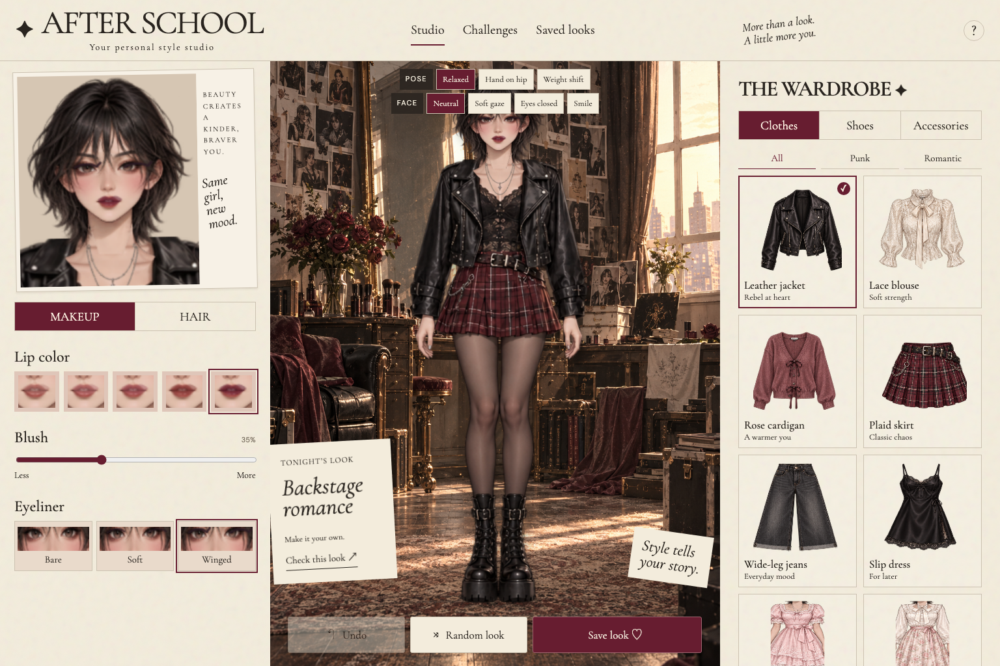
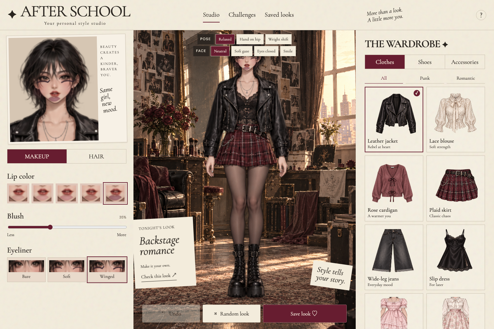
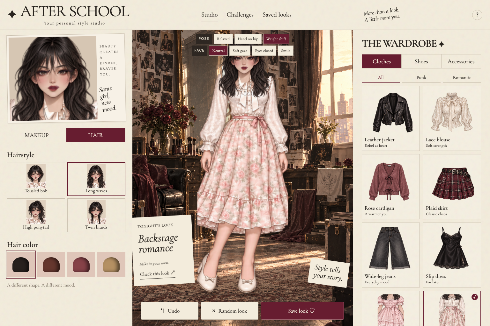
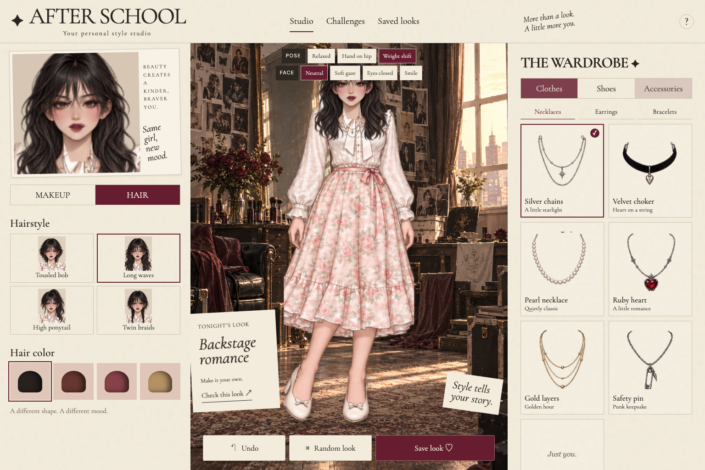
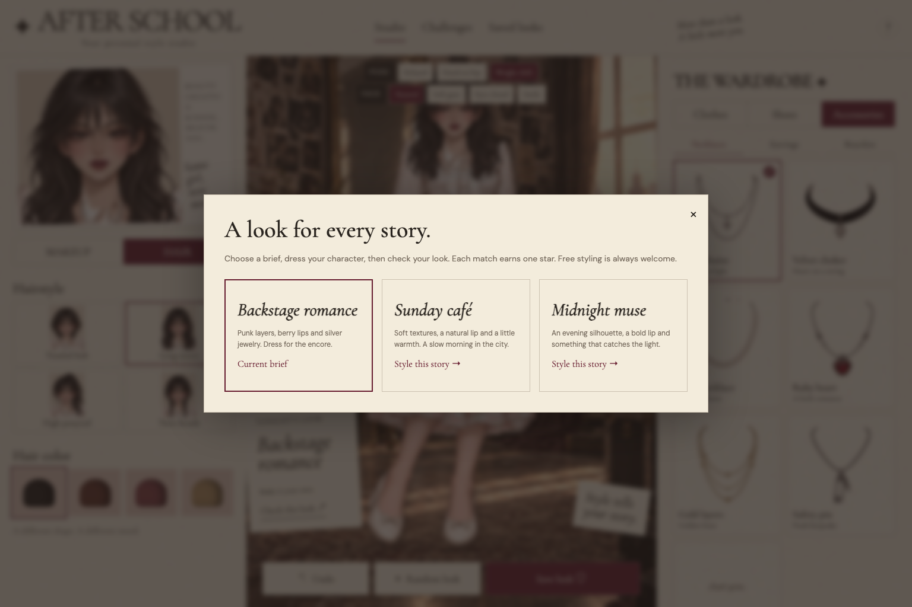
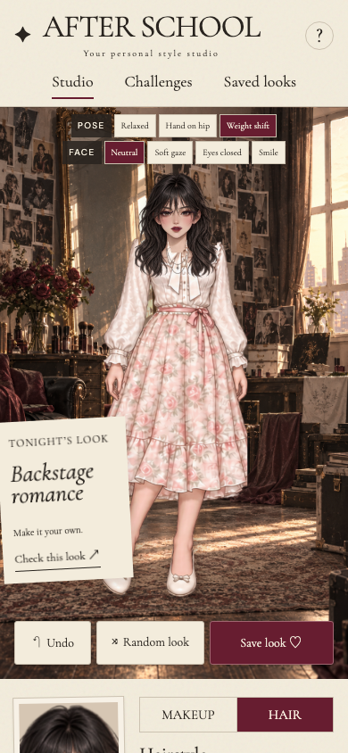

# AFTER SCHOOL

An English, single-player anime styling game inspired by romantic and punk fashion magazines. Original generated character, dressing-room and wardrobe art.

## Play
Pick from nine coordinated outfits, with Punk and Romantic wardrobe filters. Change lipstick, blush, eyeliner, hairstyle, hair color and boot finish. Mix six necklaces with three earring styles and three bracelets. Choose Relaxed, Hand on hip or Weight shift, then select Neutral, Soft gaze, Eyes closed or Smile for the character's face. The character idles with gentle breathing, a slight sway and natural blinks, and pops into each new outfit or pose (all paused for reduced-motion users). Style two characters, Nana and Hachi: switch between them at the top of the stage or tap the one standing behind, and each keeps her own look. Hachi has her own illustrated face in every hairstyle and expression. Play the Story, a five-chapter homage to Ai Yazawa's NANA: style both Nanas from the snowy train to Tokyo, through apartment 707 and Blast's first live, to a night when Trapnest is in town. Earning four stars on each scene unlocks the next chapter. Follow one of five optional styling briefs; the stage note shows your stars live as you style, and completed briefs are remembered. One brief is highlighted as today's, and finishing briefs on consecutive days builds a streak. Undo and redo (Cmd/Ctrl+Z and Shift+Z) or randomize, save up to 12 looks in your browser, download styled portraits, or copy a share link that opens any look in another browser.

This edition uses complete outfit sprites, rather than freely mixing every top and bottom. Hair controls offer a tousled bob, long waves, high ponytail and twin braids, each with four colors. Punk looks offer three platform-boot finishes; romantic looks have coordinated shoes. Makeup, hair, jewelry, pose and facial expression are reflected in the close-up, saved look and downloaded portrait.

**日本語:** The whole game is available in Japanese. Use the 日本語 / EN button in the header, or open the game with `?lang=ja`. Your choice is remembered.

**Voices:** Story chapters are narrated, and Nana and Hachi each say a line when you switch to them or earn four stars, in English or Japanese. The 🔊 button mutes them. Lines are prerecorded with macOS voices; regenerate them with `node scripts/make-voices.mjs`.

**Cutscenes:** Starting a story chapter plays a short scene: both Nanas on the dressing-room set, a slow push-in, the chapter title and narrated subtitles. Press Skip or Escape to jump straight to styling.

## Run
Serve `dist/` with any static server, for example `python3 -m http.server 5174 --directory dist`. No build, API key, backend or account is required by the game. Hosting access may depend on the site's sharing settings. Saved data stays in localStorage; clearing browser data removes the album.

## Structure
- `dist/index.html`: semantic app layout
- `dist/style.css`: responsive editorial design
- `dist/app.js`: controls, challenges, undo and saved-look storage
- `dist/art.js`: generated sprite atlas rendering and makeup compositing
- `dist/assets/`: original generated production artwork

External fonts are optional; Georgia and system sans-serif fallbacks are supplied. No analytics or uploaded photos.

## Play online

[Play AFTER SCHOOL](https://wuisabel-gif.github.io/after-school/)

## More screenshots

### Punk styling and makeup

### Romantic wardrobe and hairstyles

### Jewelry collection

### Styling challenges

### On your phone

## Deployment

GitHub Actions publishes `dist/` to GitHub Pages after every push to `main`. All asset and module paths are relative, so the game runs under the repository's Pages path. There are no server-side services or secrets.

## Fan homage

The Story mode is an unofficial fan tribute to *NANA* by Ai Yazawa. It is not affiliated with or endorsed by the creator or publishers. All text and artwork here are original.
